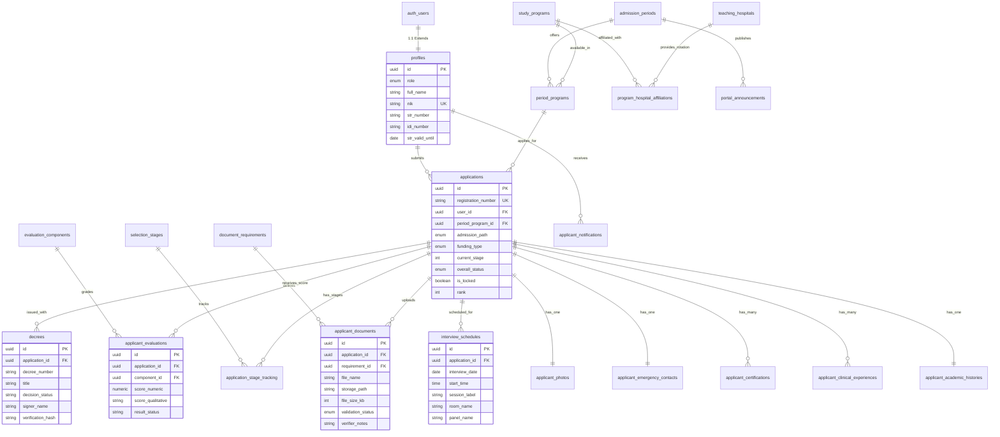

# Arsitektur Database Supabase: Portal Seleksi PPDS FK UNTAN
## Reverse Engineering & Implementasi Relasional Enterprise

Dokumen ini menyajikan rancangan basis data lengkap hasil rekayasa balik (*reverse engineering*) dari prototipe aplikasi antarmuka web **Portal Seleksi PPDS Fakultas Kedokteran Universitas Tanjungpura (UNTAN) & Konsorsium RS Pendidikan Kalimantan Barat**.

---

## 1. Pemetaan Prototipe ke Entitas Basis Data

Berdasarkan analisis mendalam terhadap 4 halaman utama prototipe, seluruh elemen antarmuka telah dipetakan secara terstruktur ke dalam entitas relasional:

| Halaman Prototipe | Komponen Antarmuka | Entitas / Tabel Database | Keterangan & Atribut Utama |
| :--- | :--- | :--- | :--- |
| **`index.html`**<br>*(Beranda & Status Seleksi)* | • Banner Kandidat & Status Utama<br>• Pelacak Tahapan (Stepper 6 Tahap)<br>• Kartu Jadwal Wawancara Mendatang<br>• Transkrip Nilai Tahap 1 & 2<br>• Integritas Berkas (8/8 / 9/9)<br>• Warta & Pengumuman<br>• Helpdesk & Kontak | `applications`<br>`selection_stages`<br>`application_stage_tracking`<br>`interview_schedules`<br>`applicant_evaluations`<br>`v_candidate_document_progress`<br>`portal_announcements`<br>`helpdesk_contacts` | Menyimpan status seleksi utama (`LULUS TAHAP 2`), status stepper aktif (`Tahap 5 • Jadwal Aktif`), skor TPA (592.50), CBT (84.20), status MMPI & MCU, serta ringkasan dokumen terverifikasi. |
| **`formulir_pendaftaran.html`**<br>*(Biodata & Pengalaman)* | • Bagian 1: Pilihan Program Studi<br>• Bagian 2: Identitas Dokter & KKI/IDI<br>• Bagian 3: Pengalaman Klinis & PIDI<br>• Sertifikasi Kegawatdaruratan<br>• Bagian 4: Kontak Darurat & Sponsor LPDP<br>• Status Terkunci & Kepatuhan UU | `study_programs`<br>`teaching_hospitals`<br>`period_programs`<br>`profiles`<br>`applicant_academic_histories`<br>`applicant_clinical_experiences`<br>`applicant_certifications`<br>`applicant_emergency_contacts`<br>`applications.is_locked` | Menangani pilihan prodi spesialis (Sp.An-TI), RS Jejaring Utama (RSUD Dr. Soedarso), nomor STR KKI, NPA IDI, almamater FK UNAIR (IPK 3.65 / 3.78), riwayat PIDI & IGD, sertifikat ACLS/ATLS/FCCS, kontak istri, serta beasiswa LPDP Targeted. |
| **`unggah_berkas.html`**<br>*(Unggah Dokumen & Foto)* | • Pasfoto Resmi Dokter 4x6<br>• Parameter Standar KKI (Snelli + Merah)<br>• Tabel 9 Dokumen Wajib Persyaratan<br>• Verifikasi Digital TTE BSrE / SatuSehat<br>• Tindakan Unduh ZIP & Pratinjau | `applicant_photos`<br>`document_requirements`<br>`applicant_documents`<br>`v_candidate_document_progress`<br>Supabase Storage: `candidate-photos`<br>Supabase Storage: `candidate-documents` | Memvalidasi 9 berkas PDF (Ijazah, STR, STSI, UKMPPD, ACLS, MCU, Narkoba/Buta Warna, Rekomendasi IDI, TOEFL ITP) dengan status per berkas (`valid`, `pending`, `needs_revision`), catatan panitia, ukuran file, dan stempel TTE. |
| **`hasil_pengumuman.html`**<br>*(Pengumuman Yudisium)* | • Banner Keputusan Yudisium Tahap 2<br>• Tabel Rincian Nilai Tahap 1 & 2<br>• Detail Sesi Wawancara & Dewan Panel<br>• Syarat Fisik Map Folio Biru rangkap 4<br>• Pratinjau Surat Keputusan (SK) Resmi<br>• Verifikasi Segel Digital & QR IDI | `decrees`<br>`applicant_evaluations`<br>`evaluation_components`<br>`interview_schedules`<br>`v_candidate_evaluations_recap`<br>Supabase Storage: `official-decrees` | Menyimpan Surat Keputusan Resmi (No: 892/SK-P2/UNTAN/2025 / SK Rektor No. 4412/UN7/PPDS/2025) tertanda Dekan FK UNTAN, ranking kohort (Peringkat 4 dari 86), jadwal wawancara 18 Agustus 2025, dewan penguji KATI, dan token verifikasi QR. |

---

## 2. Diagram Relasi Entitas (Mermaid ERD)



---

## 3. Struktur Hirarki Akses & Keamanan (RBAC & RLS)

Sistem dirancang dengan 6 tingkatan hak akses berbasis peran (*Role-Based Access Control*):

1. **`candidate` (Calon Residen / Dokter Peserta)**:
   - Dapat membaca dan menyunting formulir pendaftaran serta mengunggah berkas **hanya jika** aplikasi belum dikunci (`is_locked = false`).
   - Setelah dikunci (*Locked & Verified*), kandidat hanya memiliki akses baca (*read-only*).
   - Dapat melihat transkrip nilai yang telah dipublikasikan, jadwal wawancara, kartu peserta, dan SK Yudisium milik akunnya sendiri.
2. **`verifier` (Panitia Seleksi Berkas Administrasi)**:
   - Memiliki wewenang memeriksa dokumen yang diunggah kandidat.
   - Dapat memperbarui kolom `validation_status` (`valid`, `needs_revision`, `rejected`) serta membubuhkan catatan evaluasi `verifier_notes`.
   - Menginput skor penilaian Tahap 1 Administrasi.
3. **`assessor` (Penguji Akademik / CBT / MCU / Psikometri)**:
   - Menginput dan memvalidasi skor TPA Bappenas, nilai CBT Ilmu Anestesiologi, hasil uji klinis MMPI-2, dan status kelaikan fisik MCU.
4. **`interviewer` (Dewan Panelis Wawancara / Kolegium & KPS)**:
   - Dapat melihat portofolio kandidat, riwayat klinis, dan menginput nilai penilaian studi kasus / wawancara klinis.
5. **`admin` / `super_admin` (Dekanat & Panitia Pusat Seleksi PPDS)**:
   - Mengelola daya tampung, periode seleksi, penerbitan SK kelulusan resmi (*decrees*), pembukaan/penutupan jadwal, dan verifikasi akhir.

### Mekanisme Integritas & Immutability Trigger
Ketika pendaftar mengonfirmasi penguncian formulir:
```sql
CREATE TRIGGER trg_guard_locked_applications
    BEFORE UPDATE ON public.applications
    FOR EACH ROW EXECUTE FUNCTION public.check_application_lock();
```
Trigger `check_application_lock()` secara otomatis memblokir manipulasi baris pendaftaran dan berkas oleh kandidat untuk menjamin kepatuhan hukum dan integritas data seleksi.

---

## 4. Konfigurasi Supabase Storage

Tiga *bucket* penyimpanan dikonfigurasi untuk menangani aset statis medis:

1. **`candidate-photos`** (Publik / CDN Terproteksi, Maks 2MB, Format: `JPEG/PNG`):
   - Menyimpan pasfoto resmi calon residen (latar merah, jas snelli).
   - Akses tulis hanya diizinkan untuk pemilik akun melalui folder konvensi `{user_id}/{filename}`.
2. **`candidate-documents`** (Privat, Maks 3MB per berkas, Format: `PDF`):
   - Menyimpan 9 berkas wajib legalisir (Ijazah, STR, STSI, UKMPPD, ACLS, MCU, Narkoba, Rekomendasi, TOEFL).
   - Berkas diakses menggunakan *Signed URL* atau verifikasi sesi JWT panitia seleksi.
3. **`official-decrees`** (Publik, Maks 5MB, Format: `PDF`):
   - Menyimpan salinan Surat Keputusan (SK) Kelulusan Resmi dengan segel elektronik dan tanda tangan Dekan.

---

## 5. Panduan Instalasi & Deploy ke Supabase

### Opsi A: Menggunakan Supabase Dashboard (SQL Editor)
1. Buka dashboard proyek Supabase Anda.
2. Masuk ke menu **SQL Editor**.
3. Buat query baru, salin seluruh isi [supabase/schema.sql](file:///d:/PROJECTS/AI/PPDS/supabase/schema.sql), lalu jalankan (**Run**).
4. Buat query baru, salin seluruh isi [supabase/seed.sql](file:///d:/PROJECTS/AI/PPDS/supabase/seed.sql), lalu jalankan (**Run**) untuk mengisi data awal prototipe dr. Agung Setiawan.

### Opsi B: Menggunakan Supabase CLI
```bash
# Inisialisasi Supabase (bila belum)
npx supabase init

# Tautkan ke remote project ID
npx supabase link --project-ref your-project-id

# Eksekusi migrasi DDL
npx supabase db push

# Atau jalankan script SQL via psql
psql -h aws-0-ap-southeast-1.pooler.supabase.com -U postgres.your-project-id -d postgres -f supabase/schema.sql
psql -h aws-0-ap-southeast-1.pooler.supabase.com -U postgres.your-project-id -d postgres -f supabase/seed.sql
```

---

## 6. Verifikasi & Pengujian Data

Setelah menjalankan `schema.sql` dan `seed.sql`, Anda dapat memverifikasi keterhubungan data prototipe menggunakan query berikut:

```sql
-- 1. Uji Tampilan Beranda (index.html)
SELECT * FROM public.v_candidate_dashboard;

-- 2. Uji Kelengkapan 9 Dokumen (unggah_berkas.html)
SELECT * FROM public.v_candidate_document_progress;

-- 3. Uji Transkrip Nilai Yudisium (hasil_pengumuman.html)
SELECT * FROM public.v_candidate_evaluations_recap;
```
